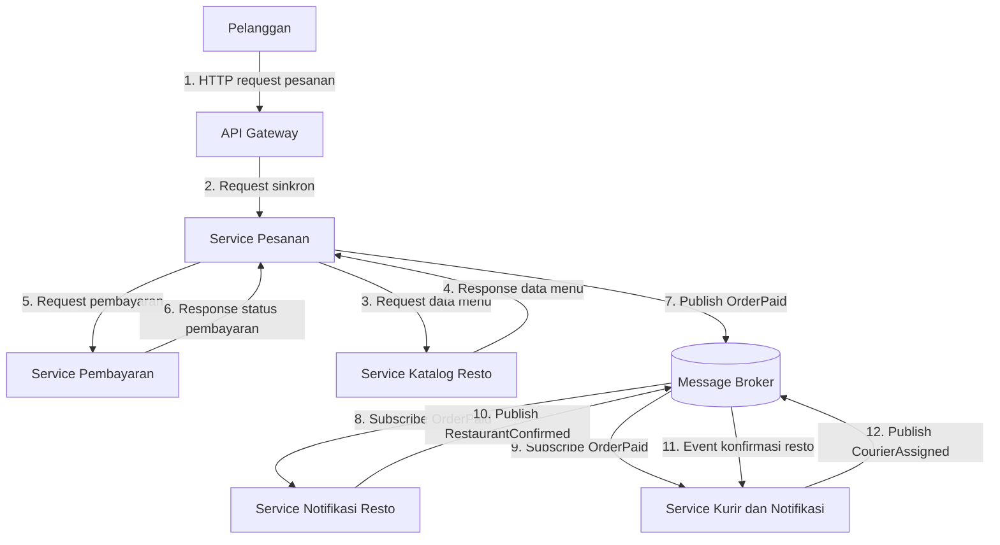

# ANALISIS TUGAS 2

## Justifikasi Gaya Arsitektur

Kita memilih kombinasi Service-Oriented Architecture (SOA) dan Publish-Subscribe (Pub-Sub) karena FoodGo membutuhkan sistem yang decoupled, yaitu setiap modul dapat bekerja dan diperbarui secara terpisah tanpa terlalu bergantung pada modul lainnya.
- SOA digunakan untuk memisahkan fungsi utama FoodGo menjadi beberapa layanan, seperti Service Pesanan, Service Pembayaran, dan Service Katalog Resto. Sementara itu, Pub-Sub digunakan untuk komunikasi berbasis event, terutama untuk mengirimkan notifikasi kepada restoran dan kurir melalui message broker tanpa harus berkomunikasi secara langsung.
- Kombinasi ini dipilih karena SOA membantu memisahkan layanan bisnis, sedangkan Pub-Sub mengurangi ketergantungan langsung dalam proses komunikasi antarlayanan. Dengan demikian, ketika salah satu layanan diperbarui atau di-deploy ulang, layanan lainnya tidak harus ikut diperbarui. Risiko gangguan pada seluruh sistem juga dapat dikurangi.
- Jika hanya menggunakan SOA, layanan memang sudah dipisahkan, tetapi komunikasi langsung melalui API dapat membuat satu layanan bergantung pada layanan lain yang dipanggilnya. Misalnya, jika Service Pesanan memanggil Service Pembayaran, gangguan pada layanan pembayaran dapat menghambat proses pesanan. Selain itu, Service Pesanan perlu memanggil layanan lain satu per satu jika ingin mengirimkan informasi kepada beberapa layanan sekaligus.
- Jika hanya menggunakan Pub-Sub, komunikasi antarlayanan menjadi lebih fleksibel karena layanan dapat bertukar informasi melalui event tanpa harus saling memanggil secara langsung. Namun, proses yang membutuhkan respons langsung, seperti memeriksa ketersediaan menu atau mengetahui hasil pembayaran, memerlukan mekanisme tambahan untuk memastikan hasilnya dapat diketahui sebelum proses dilanjutkan.

Oleh karena itu, kombinasi SOA dan Pub-Sub dipilih karena keduanya saling melengkapi. SOA membantu memisahkan layanan bisnis dan menangani komunikasi yang membutuhkan respons, sedangkan Pub-Sub mengurangi ketergantungan langsung dalam penyebaran informasi dan notifikasi. Dengan demikian, ketika salah satu layanan diperbarui atau di-deploy ulang, layanan lainnya tidak harus ikut diperbarui, sehingga risiko gangguan pada seluruh sistem dapat dikurangi.

## DIAGRAM INTERAKSI

## PENJELASAN ANALISIS (DILA)

## ANALISIS MASALAH COUPLING DAN TRADE-OFF
Kombinasi Service-Oriented Architecture (SOA) dan Publish-Subscribe (Pub-Sub) dipilih untuk mengurangi coupling pada FoodGo yang sebelumnya menggunakan arsitektur monolitik. Dengan SOA, modul Pesanan, Pembayaran, dan Katalog Resto dipisahkan menjadi layanan yang dapat diperbarui dan di-deploy secara mandiri. Sementara itu, Pub-Sub memungkinkan penyampaian informasi melalui message broker tanpa komunikasi langsung antarlayanan. Contohnya, setelah pembayaran berhasil, event OrderPaid dikirim ke layanan Notifikasi Resto dan Kurir, sehingga perubahan pada satu layanan tidak mengharuskan seluruh sistem ikut diperbarui.

Trade-off-nya, arsitektur menjadi lebih kompleks karena membutuhkan pengelolaan komunikasi, message broker, dan konsistensi data. Pub-Sub juga membuat debugging lebih sulit karena event diproses secara asinkron. Selain itu, penerapan timeout, retry, dan pemantauan service tetap diperlukan untuk menangani kegagalan komunikasi.
