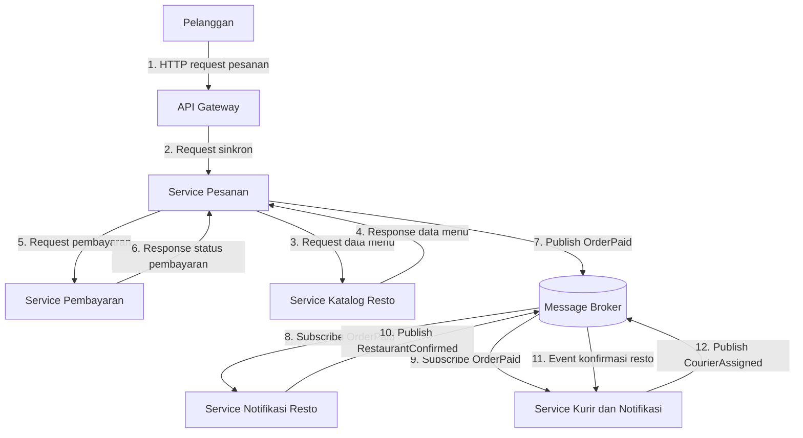

# ANALISIS TUGAS 2

## Justifikasi Gaya Arsitektur

Kita memilih kombinasi Service-Oriented Architecture (SOA) dan Publish-Subscribe (Pub-Sub) karena FoodGo membutuhkan sistem yang decoupled, yaitu setiap modul dapat bekerja dan diperbarui secara terpisah tanpa terlalu bergantung pada modul lainnya.
- SOA digunakan untuk memisahkan fungsi utama FoodGo menjadi beberapa layanan, seperti Service Pesanan, Service Pembayaran, dan Service Katalog Resto. Sementara itu, Pub-Sub digunakan untuk komunikasi berbasis event, terutama untuk mengirimkan notifikasi kepada restoran dan kurir melalui message broker tanpa harus berkomunikasi secara langsung.
- Kombinasi ini dipilih karena SOA membantu memisahkan layanan bisnis, sedangkan Pub-Sub mengurangi ketergantungan langsung dalam proses komunikasi antarlayanan. Dengan demikian, ketika salah satu layanan diperbarui atau di-deploy ulang, layanan lainnya tidak harus ikut diperbarui. Risiko gangguan pada seluruh sistem juga dapat dikurangi.
- Jika hanya menggunakan SOA, layanan memang sudah dipisahkan, tetapi komunikasi langsung melalui API dapat membuat satu layanan bergantung pada layanan lain yang dipanggilnya. Misalnya, jika Service Pesanan memanggil Service Pembayaran, gangguan pada layanan pembayaran dapat menghambat proses pesanan. Selain itu, Service Pesanan perlu memanggil layanan lain satu per satu jika ingin mengirimkan informasi kepada beberapa layanan sekaligus.
- Jika hanya menggunakan Pub-Sub, komunikasi antarlayanan menjadi lebih fleksibel karena layanan dapat bertukar informasi melalui event tanpa harus saling memanggil secara langsung. Namun, proses yang membutuhkan respons langsung, seperti memeriksa ketersediaan menu atau mengetahui hasil pembayaran, memerlukan mekanisme tambahan untuk memastikan hasilnya dapat diketahui sebelum proses dilanjutkan.

Oleh karena itu, kombinasi SOA dan Pub-Sub dipilih karena keduanya saling melengkapi. SOA membantu memisahkan layanan bisnis dan menangani komunikasi yang membutuhkan respons, sedangkan Pub-Sub mengurangi ketergantungan langsung dalam penyebaran informasi dan notifikasi. Dengan demikian, ketika salah satu layanan diperbarui atau di-deploy ulang, layanan lainnya tidak harus ikut diperbarui, sehingga risiko gangguan pada seluruh sistem dapat dikurangi.

## DIAGRAM INTERAKSI

## PENJELASAN DIAGRAM
1. Pelanggan memesan makanan (Langkah 1-2)
Pelanggan membuat pesanan lewat aplikasi mobile yang terhubung ke `API Gateway` melalui HTTP request pesanan. Kemudian `API Gateway` nya akan meneruskan request tersebut secara sinkron ke `Service Pesanan` untuk membuat entitas pesanan baru dengan status `PENDING`.
2. Pengecekan katalog & menu  (Langkah 3-4)
`Service Pesanan` akan memanggil atau request ke `Service Katalog Resto` secara sinkron untuk memastikan/validasi ketersediaan menu, harga terbaru, dan status operasional restoran. Kemudian `Service Katalog Resto` akan mengembalikan response data menu yang benar ke `Service Pesanan`.
3. Pembayaran (Langkah 5-6)
`Service Pesanan` melakukan request pembayaran secara sinkron ke `Service Pembayaran` yang proses transaksinya dilakukan melalui payment gateway. Kemudian `Service Pembayaran` akan merespons dengan status transaksi (berhasil/gagal), jika berhasil status pesanan akan diperbarui menjadi `PAID`.
4. Publish Pembayaran (Langkah 7)
Setelah pembayaran dikonfirmasi, `Service Pesanan` akan menerbitkan atau mempublish pesan `OrderPaid` ke `Message Broker`. Langkah itu dilakukan secara asinkron(non-blocking), sehingga `Service Pesanan` bisa langsung memberikan konfirmasi awal ke pelanggan tanpa harus nunggu kesiapan restoran atau kurir.
5. Notifikasi Restoran & Kurir (Langkah 8-9)
`Service Notifikasi Resto` dan `Service Kurir dan Notifikasi` yang bertindak sebagai subscriber menerima notifikasi atau pesan `OrderPaid` dari `Message Broker`. Kemudian `Service Notifikasi Resto` akan menampilkan pesanan masuk di dashboard restoran agar makanannya bisa mulai disiapkan oleh restoran.
6. Konfirmasi Restoran & Penugasan Kurir (Langkah 10-12)
Setelah restoran mengkonfirmasi pesanan, `Service Notifikasi Resto` akan mempublikasikan pesan `RestaurantConfirmed` ke `Message Broker`. `Service Kurir dan Notifikasi` akan menerima pesan tersebut, lalu dia akan secara otomatis mencocokkan dan menugaskan kurir terdekat serta menerbitkan pesan `CourierAssigned` ke `Message Broker`.

## ANALISIS MASALAH COUPLING DAN TRADE-OFF
Kombinasi Service-Oriented Architecture (SOA) dan Publish-Subscribe (Pub-Sub) dipilih untuk mengurangi coupling pada FoodGo yang sebelumnya menggunakan arsitektur monolitik. Dengan SOA, modul Pesanan, Pembayaran, dan Katalog Resto dipisahkan menjadi layanan yang dapat diperbarui dan di-deploy secara mandiri. Sementara itu, Pub-Sub memungkinkan penyampaian informasi melalui message broker tanpa komunikasi langsung antarlayanan. Contohnya, setelah pembayaran berhasil, event OrderPaid dikirim ke layanan Notifikasi Resto dan Kurir, sehingga perubahan pada satu layanan tidak mengharuskan seluruh sistem ikut diperbarui.

Trade-off-nya, arsitektur menjadi lebih kompleks karena membutuhkan pengelolaan komunikasi, message broker, dan konsistensi data. Pub-Sub juga membuat debugging lebih sulit karena event diproses secara asinkron. Selain itu, penerapan timeout, retry, dan pemantauan service tetap diperlukan untuk menangani kegagalan komunikasi.
